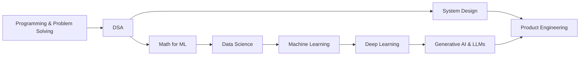

<div align="center">


<a href="https://github.com/NandanvarKrish">
  
</a>

<br/>

<a href="https://github.com/NandanvarKrish">
  
</a>
<a href="https://www.linkedin.com/in/krish-nandanvar-877b02424/">
  
</a>
<a href="https://instagram.com/offtopic_programmerz">
  
</a>

<br/><br/>


</div>


## `$ whoami`


Hey! I'm **Krish Nandanvar** 👋, an AI/ML undergraduate from **Surat, Gujarat, India**.

I'm interested in the intersection of **software engineering** and **artificial intelligence**. I enjoy figuring out how technology works, building software products, and learning the engineering principles behind them.

```python
class Krish:
    role      = "AI/ML Undergraduate @ CKPCET, Surat"
    location  = "Surat, Gujarat, India 🇮🇳"
    focus     = ["Software Engineering", "Machine Learning", "Generative AI"]
    currently = "Building products & learning by experimenting"
    motto     = "Learn deeply. Build consistently. Improve continuously."

    def open_to(self):
        return ["learning", "collaboration", "building meaningful things"]
```

<br clear="right"/>


## 🧭 My Direction

<div align="center">

| 🛠️ Software Engineering | 🤖 Artificial Intelligence |
|:---:|:---:|
| Problem Solving | Machine Learning |
| Data Structures & Algorithms | Deep Learning |
| Backend Development | Data Science |
| System Design | Generative AI |
| Product Engineering | AI Engineering |

</div>

> 🎯 **Long-term goal:** become an engineer who can build complete, useful products — from reliable software foundations to intelligent, AI-powered systems.


## 🛠️ Technology & Tools

*Technologies that are part of my learning and development journey — not a claim of expert-level proficiency.*

<div align="center">

**Programming**


**Development & Tools**


**Currently Exploring**


</div>


## 🚀 Selected Projects

<div align="center">

<a href="https://github.com/NandanvarKrish/LUNA-AI">
  
</a>
<a href="https://github.com/NandanvarKrish/Inventory-and-Billing-management-SaaS">
  
</a>
<a href="https://github.com/NandanvarKrish/Clothing-Brand-SaaS">
  
</a>
<a href="https://github.com/NandanvarKrish/SIH26208">
  
</a>

</div>

<br/>

<table>
<tr>
<td width="50%" valign="top">

### 🌙 LUNA AI
**Personal AI assistant**

An ongoing project exploring how to design and build an AI-powered assistant.

`Python` `AI` `LLMs`

[View Repository →](https://github.com/NandanvarKrish/LUNA-AI)

</td>
<td width="50%" valign="top">

### 📦 Inventory & Billing SaaS
**Business software**

Inventory management and billing workflows built for real business use cases.

`SaaS` `Backend` `Full-Stack`

[View Repository →](https://github.com/NandanvarKrish/Inventory-and-Billing-management-SaaS)

</td>
</tr>
<tr>
<td width="50%" valign="top">

### 👗 VÉLURE ATELIER
**Fashion e-commerce**

A premium, design-focused fashion e-commerce experience.

`E-Commerce` `UI/UX` `SaaS`

[View Repository →](https://github.com/NandanvarKrish/Clothing-Brand-SaaS)

</td>
<td width="50%" valign="top">

### 🇮🇳 BharatVerse — SIH26208
**Smart India Hackathon**

A team project built during the Smart India Hackathon journey.

`Hackathon` `Teamwork` `Problem Solving`

[View Repository →](https://github.com/NandanvarKrish/SIH26208)

</td>
</tr>
</table>

<details>
<summary><b>📂 More projects</b></summary>
<br/>

| Project | What it is |
|:---|:---|
| [🌐 Portfolio](https://github.com/NandanvarKrish/Portfolio) | My personal portfolio website |
| [📚 Smart Study Tracker](https://github.com/NandanvarKrish/Smart-Study-Tracker) | A web app to plan and track study progress |
| [🧠 Learning AI/ML](https://github.com/NandanvarKrish/Learning-AI-ML) | Notes, practice and experiments from my AI/ML journey |
| [⚙️ DSA](https://github.com/NandanvarKrish/DSA) | Data Structures & Algorithms practice |

</details>


## 📚 Currently Learning



<details>
<summary><b>🔎 Full learning list</b></summary>
<br/>

- Programming fundamentals and problem solving
- Data Structures and Algorithms
- Mathematics for Machine Learning
- Data Analytics and Data Science
- Machine Learning fundamentals
- Deep Learning and Neural Networks
- Generative AI and LLM Engineering
- Software architecture and system design

</details>


## 📊 GitHub Statistics

<div align="center">


<br/><br/>


<br/><br/>


<br/><br/>


</div>


## 🐍 Contribution Activity

<div align="center">


</div>


## 💡 My Philosophy

<div align="center">


### Learn deeply. Build consistently. Improve continuously.

I believe the best way to understand technology is to build with it, experiment, make mistakes, and keep improving.

<br/>


</div>


## 🌐 Find Me Online

<div align="center">

<a href="https://github.com/NandanvarKrish">
  
</a>
<a href="https://www.linkedin.com/in/krish-nandanvar-877b02424/">
  
</a>
<a href="https://instagram.com/offtopic_programmerz">
  
</a>

<br/><br/>

**🤝 Open to learning, collaboration and building meaningful things.**

<br/>


</div>
